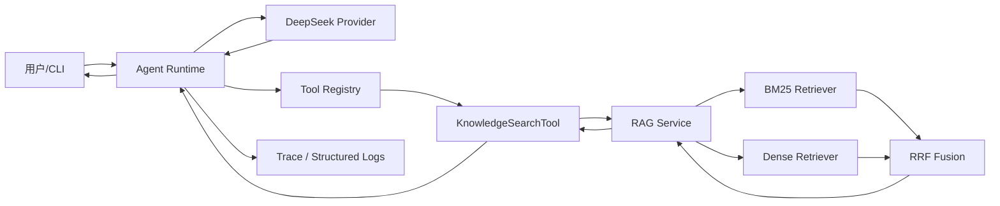
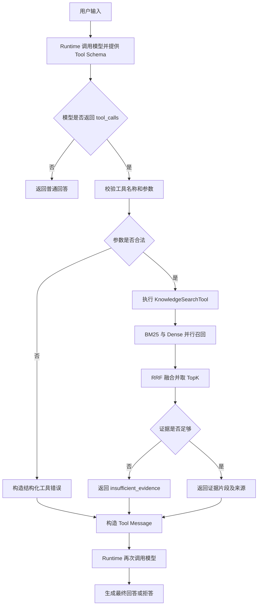
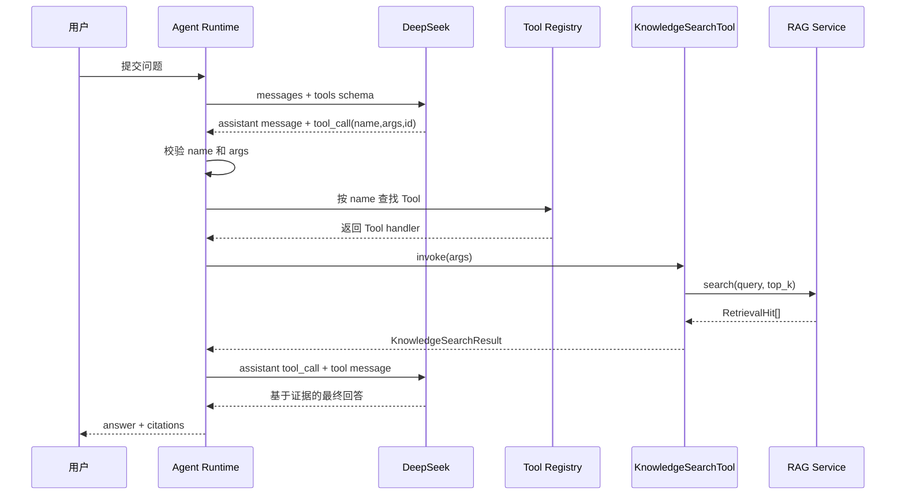
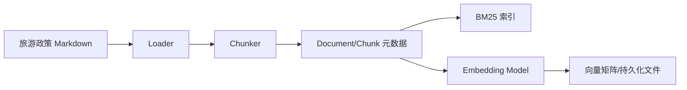

# DevAgent 需求与技术设计（v0.1 草案）

> 文档状态：Proposed  
> 目标周期：2～3 天完成最小可运行与可评测闭环  
> 当前定位：面向虚构旅游预订平台的知识库客服 Agent  
> 原则：先跑通主链路，再迭代检索、服务化、部署和可观测能力

## 1. 文档怎么使用

这不是一次写死的最终方案，而是一份随开发更新的工程文档。每项重要决策使用以下状态：

- `Proposed`：当前计划，尚未实现或验证；
- `Validated`：已通过代码、测试或实验验证；
- `Changed`：开发中发现原方案不合适，已记录替代方案和原因；
- `Deferred`：确认有价值，但不属于当前版本。

开发前先确定需求、边界、接口和验收方式；开发后回填实际指标、问题和选型变化。不得在实现前填写虚构的性能或准确率数据。

## 2. 业务背景与需求分析

### 2.1 业务背景

假设存在一个虚构的旅游预订平台“行旅助手”。平台维护机票、酒店和平台服务相关的政策文档。用户经常咨询：

- 机票退票、改签和行李规则；
- 酒店入住、取消和退款规则；
- 平台优惠券、发票和售后处理流程；
- 找不到对应政策时如何转人工。

传统关键词搜索要求用户知道准确术语；直接让大模型回答又可能脱离平台政策产生幻觉。因此需要一个能够自主决定是否查询知识库、基于证据回答、证据不足时拒答的客服 Agent。

### 2.2 目标用户

- 旅游平台普通用户；
- 需要快速查找政策的客服人员；
- 演示和评测该 Agent 的开发者。

### 2.3 MVP 目标

1. 接收用户自然语言问题；
2. 普通寒暄无需检索即可回答；
3. 政策问题由模型调用 `KnowledgeSearchTool`；
4. 工具从知识库返回 TopK 证据片段；
5. 模型只基于证据生成回答并标注来源；
6. 证据不足时明确拒答并建议转人工；
7. 为工具、Runtime 和检索模块提供自动化测试；
8. 使用离线数据集比较 BM25、Dense 和 Hybrid RRF；
9. 记录一次请求的工具调用、耗时、命中片段和异常信息。

### 2.4 MVP 非目标

- 不连接真实订单、支付和退款系统；
- 不执行自动退票、改签等有业务副作用的操作；
- 不使用真实用户隐私数据；
- 不做知识图谱、多 Agent、长期记忆和复杂工作流；
- 不承诺生产级并发、容灾和检索规模；
- 不接入实时航班、天气和签证政策。

### 2.5 核心用户故事

#### 场景 A：知识库内问题

用户询问：“酒店入住前一天取消，需要手续费吗？”

系统应调用知识库工具，返回依据平台取消政策生成的回答，并给出文档来源。

#### 场景 B：知识库外问题

用户询问知识库没有覆盖的目的地实时政策。

系统应说明证据不足，不得编造答案，并建议咨询人工客服或官方渠道。

#### 场景 C：普通寒暄

用户输入“你好”。

系统可直接回答，不应无意义地调用知识库。

## 3. 版本规划与技术选型

### 3.1 V1：最小 Tool Calling Agent

目标：先看懂并跑通 LLM、Runtime 和 Tool 的完整闭环。

范围：

- 使用 OpenAI Python SDKe 调用 DeepSek 的 OpenAI 兼容接口；
- 手写 Tool JSON Schema，不先引入 LangChain；
- 模型返回 `tool_calls`；
- Runtime 校验参数、查找工具、执行 Python 函数；
- 将结果作为 Tool Message 回填模型；
- `KnowledgeSearchTool` 先返回固定或简单关键词搜索结果；
- CLI 完成一次端到端交互；
- 模型调用使用 Mock 完成稳定的集成测试。

选择手写 Runtime 的原因：

- 当前阶段的学习目标是理解 Tool Calling 的本质；
- 项目已经使用 OpenAI SDK，没有必要为一个循环立即引入大型框架；
- 后续接入 LangGraph 时可以明确知道框架替自己封装了什么。

### 3.2 V2：混合检索 RAG

目标：让 `KnowledgeSearchTool` 从真实文档索引返回证据。

范围：

- Markdown/TXT 文档加载；
- 文本切分并保留来源元数据；
- BM25 关键词召回；
- Sentence Transformers 本地向量召回；
- NumPy 余弦相似度计算；
- 加权 RRF 融合；
- TopK 证据和引用；
- 无答案门控；
- 离线评测和消融实验。

第一版不使用专用向量数据库。对于几十份文档和数百到数千个 Chunk，内存向量加 NumPy 足够简单、透明、可测试。此阶段重点是理解：

```text
文本 → Chunk → Embedding → 相似度 → 排名 → RRF → TopK
```

### 3.3 V3：可部署服务

目标：把本地 Agent 变成可访问、可追踪的服务。

候选范围：

- FastAPI `/chat`、`/health` 接口；
- 可选 SSE 流式返回；
- Docker 镜像；
- 阿里云部署；
- 请求限流和基础鉴权；
- 结构化日志、Trace ID、Token 与延迟统计；
- 本地持久化索引或外部数据库；
- 根据实际规模选择 pgvector、Qdrant、Milvus 或搜索引擎。

V3 不属于前两天的强制范围；前两天应优先保证 V1、V2 可以运行、测试和解释。

### 3.4 向量存储演进与选择条件

| 阶段 | 方案 | 适用条件 | 优点 | 代价/边界 |
| --- | --- | --- | --- | --- |
| V2 | NumPy 内存检索 | 数百～数千 Chunk | 代码透明、依赖少、便于学习 | 重启需重载，不适合大规模 |
| V3-A | FAISS/本地索引 | 单机、主要做向量近邻 | 检索高效、部署简单 | 元数据和多用户管理较弱 |
| V3-B | PostgreSQL + pgvector | 已需要关系数据和过滤 | 一套数据库同时管理业务与向量 | 极大规模 ANN 能力有限 |
| V3-C | Qdrant | 中等规模、需要过滤和向量服务 | API 清晰、向量能力专门化 | 增加独立服务运维 |
| 以后 | Milvus | 大规模向量与分布式需求明确 | 扩展能力强 | 对当前项目过重 |

数据库选型必须依据实际 Chunk 数、查询量、过滤需求、服务器资源和运维能力决定，不提前为了“技术含量”引入复杂组件。

### 3.5 其他选型

| 能力 | V1/V2 选择 | 原因 |
| --- | --- | --- |
| 开发语言 | Python 3.10/3.11 | 当前代码基础、模型生态成熟；部署前固定小版本 |
| Chat Model | DeepSeek，模型名通过环境变量配置 | 当前已有 Provider；避免硬编码模型版本 |
| Tool 参数校验 | Pydantic v2 | 同一模型可生成 JSON Schema 并执行运行时校验 |
| 中文 BM25 | `jieba` + `rank_bm25` | 明确展示分词和关键词召回链路 |
| Dense Retrieval | Sentence Transformers | 可本地运行，便于复现和部署 |
| Vector Similarity | NumPy cosine similarity | 小规模足够，算法过程透明 |
| 测试 | 继续使用 `unittest` | 当前测试已经采用该框架，避免无意义切换 |
| 第一交互入口 | CLI | 最快验证主链路；Web API 后置 |

## 4. 架构、接口契约与数据链路

这一部分用三种图回答不同问题：

- 架构图：系统由哪些模块组成；
- 流程图：一次请求可能走哪些分支；
- 时序图：一次 Tool Call 到底是谁先调用谁。

### 4.1 总体架构图



### 4.2 请求流程图



### 4.3 Tool Calling 时序图



### 4.4 文档索引数据链路



### 4.5 核心数据契约（伪代码）

以下代码用于定义模块边界和帮助理解，不要求第一天全部原样实现。

```python
class Document:
    document_id: str
    title: str
    source: str
    content: str
    metadata: dict


class Chunk:
    chunk_id: str
    document_id: str
    content: str
    position: int
    source: str
    metadata: dict


class RetrievalHit:
    chunk_id: str
    content: str
    source: str
    rank: int
    score: float
    retrieved_by: list[str]  # ["bm25"], ["dense"] 或两者


class KnowledgeSearchArgs:
    query: str
    top_k: int = 5


class KnowledgeSearchResult:
    ok: bool
    query: str
    hits: list[RetrievalHit]
    sufficient_evidence: bool
    error: dict | None


class ToolCall:
    id: str
    name: str
    arguments: dict


class ToolResult:
    tool_call_id: str
    name: str
    content: dict


class AgentState:
    messages: list
    turn_count: int
    tool_call_count: int
    trace_id: str
```

### 4.6 Tool 定义（伪代码）

```python
class ToolDefinition:
    name: str
    description: str
    parameters: dict       # JSON Schema
    function: Callable


knowledge_search_tool = ToolDefinition(
    name="knowledge_search",
    description="Search travel platform policies and return evidence chunks.",
    parameters=KnowledgeSearchArgs.model_json_schema(),
    function=knowledge_search,
)
```

Tool Schema 是 LLM 与 Runtime 之间的接口；`function` 是 Runtime 最终执行的 Python 实现。

### 4.7 Runtime 主循环（伪代码）

```python
def run_agent(user_message):
    messages = [{"role": "user", "content": user_message}]

    for _ in range(MAX_TOOL_ROUNDS):
        assistant_message = provider.chat(
            messages=messages,
            tools=registry.schemas(),
        )
        messages.append(assistant_message)

        if not assistant_message.tool_calls:
            return assistant_message.content

        for call in assistant_message.tool_calls:
            result = registry.invoke(
                name=call.name,
                raw_arguments=call.arguments,
            )
            messages.append({
                "role": "tool",
                "tool_call_id": call.id,
                "content": json.dumps(result),
            })

    return "工具调用次数超过限制，已停止执行"
```

### 4.8 Hybrid Retrieval（伪代码）

```python
def search(query, top_k=5):
    bm25_hits = bm25_retriever.search(query, limit=20)
    dense_hits = dense_retriever.search(query, limit=20)

    fused = rrf_fuse(
        rankings=[bm25_hits, dense_hits],
        weights=[1.0, 1.0],
        k=60,
    )

    hits = deduplicate(fused)[:top_k]
    sufficient = relevance_gate(query, hits)

    return KnowledgeSearchResult(
        ok=True,
        query=query,
        hits=hits if sufficient else [],
        sufficient_evidence=sufficient,
        error=None,
    )
```

加权 RRF：

```text
score(document) = Σ weight_i / (k + rank_i(document))
```

第一版使用等权；只有离线验证表明某一路需要更高权重时才调整。

## 5. 最小物理模块划分

为了在 2～3 天内完成，不把文件拆得过细：

```text
src/devagent/
├── agent.py                 # Runtime 主循环
├── schemas.py               # Tool、检索和消息契约
├── providers/
│   └── deepseek_provider.py # 模型调用
├── tools/
│   ├── registry.py          # Schema、注册和统一分发
│   └── knowledge_tool.py    # KnowledgeSearchTool
├── rag/
│   └── service.py           # Loader、Chunk、BM25、Dense、RRF 的 MVP 实现
└── cli/
    └── app.py               # 本地入口
```

当 `rag/service.py` 变得难以理解或测试时，再拆成 loader、retriever 和 fusion 文件。模块化的目标是边界清晰，不是文件越多越好。

## 6. 开发与学习方式：输出倒逼输入

每完成一个模块，必须有四类输出：

1. **运行输出**：模块能实际执行；
2. **测试输出**：至少一个正常用例和一个异常用例；
3. **解释输出**：能根据本文档的图说清输入、输出和调用者；
4. **代码问答输出**：针对刚完成的代码回答一道具体问题。

每个抽象只要求深入一个代表实现：

- 一个 Tool：`KnowledgeSearchTool`；
- 一个 Runtime 分支：模型返回 `tool_calls`；
- 一个 Retriever：先看懂 BM25 或 Dense 的完整实现；
- 一个融合算法：RRF；
- 一个端到端测试：Mock 模型返回 Tool Call，最终得到答案。

通过标准不是背下全部源码，而是能够回答：

```text
谁构造输入？
谁调用当前模块？
当前模块返回什么？
失败怎样表达？
下一个模块是谁？
对应测试在哪里？
```

## 7. 测试与验证计划

### 7.1 单元测试

- Tool Schema 是否包含名称、描述、参数和必填项；
- Tool Registry 能否按名称分发并拒绝未知工具；
- 参数类型错误是否在执行前被拒绝；
- 非法 JSON 是否返回结构化错误；
- 文档切分是否保留 `source` 和 `chunk_id`；
- BM25 是否命中精确错误码和政策术语；
- Dense 是否命中语义近似问题；
- RRF 是否按预期融合、去重并保持确定性；
- 无结果时是否返回 `sufficient_evidence=False`；
- Shell 命令非零退出码是否返回 `ok=False`；
- 工作区路径越界仍然被拒绝。

### 7.2 集成测试

使用 Mock Provider 固定返回：

1. 一次 `knowledge_search` Tool Call；
2. Runtime 执行工具；
3. Tool Message 正确关联 `tool_call_id`；
4. 第二次模型响应返回最终答案。

另测试：

- 模型直接回答，不调用工具；
- 模型调用不存在的工具；
- 模型连续调用超过上限；
- Tool 内部抛出异常；
- Provider 超时或鉴权失败。

真实 API 只用于少量 smoke test，避免单元测试依赖网络和付费模型。

### 7.3 离线评测集

初始建议 30 条人工标注问题：

- 20 条知识库内语义改写问题；
- 5 条依赖精确术语、编号或错误码的问题；
- 5 条知识库外问题。

每条数据至少包含：

```json
{
  "question": "酒店入住前一天取消是否收费？",
  "relevant_chunk_ids": ["hotel-cancel-001"],
  "expected_answer_points": ["取消时限", "手续费条件"],
  "should_abstain": false
}
```

不得直接把评测问题原样写进知识文档；应使用同义改写，降低数据泄漏。

### 7.4 对比与消融实验

| 组别 | 检索方式 | 目的 |
| --- | --- | --- |
| A0 | LLM Only | 无检索基线，观察幻觉 |
| A1 | BM25 Only | 测量关键词召回贡献 |
| A2 | Dense Only | 测量语义召回贡献 |
| A3 | BM25 + Dense + RRF | 验证融合是否提升 |

检索指标：

- Recall@5；
- MRR@10；
- Top1 命中率。

回答指标：

- 关键答案点覆盖率；
- 引用来源正确率；
- 知识库外问题拒答准确率；
- 人工抽查的证据一致性。

初始发布阈值只能作为 `Proposed`：

- Recall@5 ≥ 0.80；
- 引用来源正确率 ≥ 0.90；
- 知识库外问题拒答准确率 ≥ 0.80；
- 所有关键边界用例通过。

样本较小时必须同时报告样本数，不把小数据集结果描述成生产结论。

### 7.5 轻量性能测试

当前不做高并发压测，只记录：

- 文档索引构建耗时；
- 单次 BM25、Dense、RRF 的耗时；
- 端到端平均延迟与 P95；
- 单请求 Token 使用量；
- 1、3、5 并发下是否出现错误和明显资源问题。

### 7.6 边界与鲁棒性用例

- 空输入、纯空格、超长输入；
- 中英文混合；
- `top_k=0`、负数和极大值；
- 空知识库、索引损坏、Chunk 重复；
- 无相关证据、证据相互矛盾；
- Tool 参数非法 JSON 或缺字段；
- 模型捏造不存在的工具名；
- Tool 返回不可序列化内容；
- Provider 超时、限流和鉴权失败；
- 检索文档中包含“忽略系统指令”等提示词注入文本；
- API Key 缺失；
- Shell 命令返回非零状态码。

### 7.7 MVP 发布门禁

以下条件未满足不得标记 V2 完成：

- 单元测试和集成测试全部通过；
- 真实 API smoke test 至少完成一次 Tool Call 闭环；
- A0～A3 对比脚本可重复运行；
- 指标文件记录样本数、配置和结果；
- 知识库外问题不会默认编造回答；
- README 中提供从安装到运行的可复现步骤；
- `.env.example` 与代码实际读取的变量一致；
- 不在代码、日志和仓库中保存真实密钥。

## 8. 两到三天开发计划

### Day 1：Tool Calling 主链路

- 修正环境变量和依赖安装；
- 为 ToolDefinition 增加 JSON Schema；
- Provider 返回完整 Assistant Message；
- 实现 Runtime 循环和工具统一分发；
- `KnowledgeSearchTool` 先使用固定结果；
- 完成直接回答、一次工具调用、未知工具、非法参数测试；
- 输出并口述一次完整时序图。

### Day 2：RAG 与离线评测

- 准备约 20 份虚构旅游平台政策文档；
- 实现加载、Chunk 和来源元数据；
- 实现 BM25、Dense 和 RRF；
- 接入 KnowledgeSearchTool；
- 构造约 30 条离线评测问题；
- 跑 A0～A3 对比并保存真实结果；
- 完成无答案门控和引用。

### Day 3：工程收口

- 补齐边界用例和失败路径；
- 增加结构化日志和 Trace ID；
- 记录延迟、Token 和错误；
- 更新 README、架构图和实际指标；
- 可选增加 FastAPI `/chat` 和 `/health`；
- 若时间不足，优先保证 CLI 可复现，服务化和云部署标记为 Deferred。

## 9. 部署规划

### V1/V2

- 本机 CLI；
- 本地文档与索引；
- `.env` 提供密钥；
- 不对公网开放。

### V3

- FastAPI 服务；
- Docker 构建；
- 阿里云安全组只开放必要端口；
- Nginx 或云网关终止 HTTPS；
- API 鉴权与速率限制；
- 密钥由环境变量或密钥服务注入；
- 不在日志记录完整用户隐私和模型密钥。

## 10. 可观测与运维规划

每个请求至少记录：

- `trace_id`；
- 请求开始和结束时间；
- 模型名称；
- Tool Call 名称和参数摘要；
- Tool 成功/失败及错误码；
- 检索方式、命中 Chunk ID 和来源；
- 各阶段耗时；
- 输入/输出 Token；
- 最终状态：answered、abstained、failed。

第一版写 JSON Lines 日志即可；只有出现实际查询和运维需求后再引入专门的监控系统。

## 11. 当前待确认与已知风险

### 已采用的暂定方案

- 虚构旅游平台政策客服；
- 不连接真实订单和退款；
- DeepSeek Tool Calling；
- 手写最小 Runtime；
- 本地 Embedding + NumPy；
- BM25 + Dense + RRF；
- CLI 优先；
- 测试和评测先定义、结果后回填。

### 风险

- 本地 Embedding 模型首次下载和 CPU 推理可能影响两天进度；
- 中文 BM25 的分词质量会影响结果；
- 小评测集指标波动较大；
- 模型 Tool 参数不保证天然合法，必须在 Runtime 校验；
- RRF 分数不是概率，不能直接当作置信度；
- 模型最终回答仍可能偏离证据，需要引用约束和拒答策略；
- 如果过早加入 Web、数据库和多 Agent，会挤压主链路与评测时间。

## 12. 变更记录

| 版本 | 状态 | 说明 |
| --- | --- | --- |
| v0.1 | Proposed | 明确旅游客服 MVP、三阶段架构、接口契约、测试评测和 2～3 天开发计划 |

